# 個別化照護系統｜院長向主管機關報告用介紹

- 對象：主管機關
- 報告人：院長
- 建議時間：10 分鐘（開場 1 分、六階段 6 分、成果與保障 2 分、結語 1 分）
- 撰寫規範：TPI Simplified Technical Writing Style（tpi-ste）
- 說明：本文件中的資料皆為示範資料。系統目前為展示版。

---

## 0. 院長開場：一句話

> 透過數位化工具，整合跨專業照護資訊，落實以病人為中心的個別化復健，促進生活功能恢復與返家銜接。

建議講三個重點。

1. 資訊整合：整合不同職種的評估結果、復健目標與照護資訊，建立一致的數位化呈現方式。
2. 跨專業協作：以病人生活需求為核心，促進團隊共同掌握照護目標與復健進度。
3. 個別化照護：依據個案功能狀態與生活目標，制定及調整復健計畫，支持功能恢復與返家準備。

---

## 1. 為什麼需要這套系統

| 現況問題 | 系統作法 |
|---|---|
| 復健目標由醫療人員單方訂定 | 由病人與家屬先選「生活願望」 |
| 各專業各自記錄，資料分散 | 一位病人只有一份主檔。各專業共用 |
| 計畫修訂沒有紀錄 | 每次修訂產生新版本，並留下原因與操作者 |
| 病人不知道自己進步多少 | 生活功能護照顯示 150 項任務的解鎖進度 |

---

## 2. 一張圖看完：六個階段

```
 入院                                                              出院
  │                                                                 │
  ▼                                                                 ▼
┌────────┐   ┌────────┐   ┌────────┐   ┌────────┐   ┌────────┐   ┌────────┐
│ ① 建檔 │──▶│ ② 認識 │──▶│ ③ 選願 │──▶│ ④ 功能 │──▶│ ⑤ 選任 │──▶│ ⑥ 計畫 │
│        │   │  病人  │   │  望    │   │  象限  │   │  務    │   │  與追蹤│
└────────┘   └────────┘   └────────┘   └────────┘   └────────┘   └───┬────┘
 個案主檔     跨專業共填    28 張圖卡     重要×急迫     150 項任務      │
 照護模式     熟識人資料    先初選再確認  病人與家屬拖  與願望連結      ▼
                                                              ┌────────────┐
                                                              │ 生活功能   │
                                                              │ 解鎖護照   │──▶ 出院成果（規劃）
                                                              └────────────┘
```

**這六步的主角**

```
 ① 建檔 ........ 護理／行政
 ② 認識病人 .... PT／OT／ST／營養／醫師／藥師／護理／社工（其他身分可彈性增加）
 ③ 選願望 ...... 病人與家屬
 ④ 生活功能象限 病人與家屬
 ⑤ 選任務 ...... 治療師
 ⑥ 計畫與追蹤 .. 治療師與團隊
```

---

## 3. 六個階段說明

### 階段 ①：入院建檔（建立個案主檔）

**做什麼**

- 護理人員建立病人主檔。
- 系統給病人一個獨立的系統 ID。
- 系統預留病歷號、PAC、杏翔三個識別碼欄位。
- 記錄病人的「照護模式」。

**照護模式有四種**

```
 PAC ◀──▶ 復健病房 ◀──▶ 一般復健 ◀──▶ OPD
   （病人可隨時轉換，舊照護模式保留在歷程中，不覆蓋）
```

**六種階段**

入院到出院共有六個階段（見第 2 節）。照護模式是病人所在的照護類型，從入院到出院的任何時間都可能轉換；各流程階段的操作都寫入操作紀錄。

**院長可強調**

- 若病人轉換照護模式，系統新增一筆歷程。系統不覆蓋舊資料。
- 院方可設定哪些照護模式必須做復健計畫。

**系統操作畫面**

操作步驟：

1. 開啟系統，進入「① 個案主檔」，選擇病人（例：張伯伯）。
2. 畫面上方的流程圖，依病人目前的照護模式自動帶出後續路徑。
3. 右側「照護模式歷程」顯示 復健病房 → PAC。舊紀錄保留。
4. 按「變更照護模式」，選新的照護模式、生效日期與備註，再按「確認變更」。

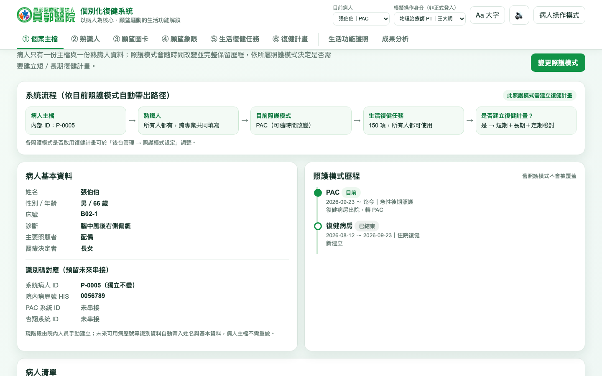

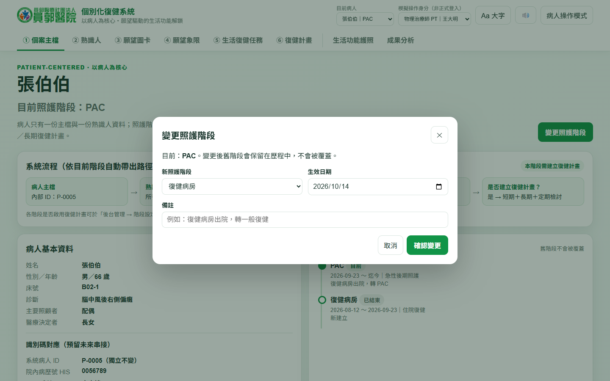

> 圖說：上圖為主檔與照護模式歷程。下圖為照護模式變更視窗。系統預留病歷號、PAC、杏翔識別碼。

---

### 階段 ②：認識病人（熟識人資料）

**做什麼**

- 八個專業各自填寫自己的區塊。管理員可依需要增加其他區塊，例如家屬或其他參與者。
- 系統記錄填寫者、填寫時間、歷次內容。

```
              ┌──────── 跨專業總覽 ────────┐
              │                            │
   PT ─┐      │                            │
   OT ─┤      │   一位病人                  │
   ST ─┤      │   一份熟識人資料            │
 營養 ─┤      │   （各專業欄位分開，        │
 醫師 ─┼─────▶│    不互相覆蓋）            │
 藥師 ─┤      │                            │
 護理 ─┤      │                            │
 社工 ─┤      │                            │
 其他 ─┘      └────────────────────────────┘
 （其他：後台可彈性增加，例如家屬）
```

**院長可強調**

- 各專業不必重複問病人同樣的問題。
- 每次修改都有記錄，可以追查。

**系統操作畫面**

操作步驟：

1. 進入「② 熟識人」，先看「跨專業總覽」。
2. 點各專業分頁（PT、OT、ST、營養、醫師、藥師、護理、社工），填寫自己的欄位。
3. 儲存後，系統記錄填寫者與時間。歷次內容可回看。

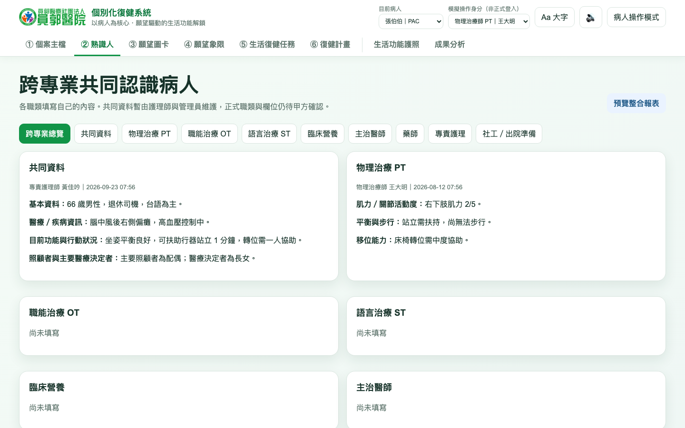

> 圖說：共同資料與 PT 區塊並列。每個區塊都標示填寫者與時間。

---

### 階段 ③：選願望（願望圖卡）

**做什麼**

- 病人或家屬從 28 張圖卡挑選自己的願望。
- 若圖卡沒有想要的願望，病人可新增自訂願望。
- 每張圖卡的第二層文字，就是「患者預期目標」。

```
   ┌──────┐ ┌──────┐ ┌──────┐ ┌──────┐
   │ 喝湯麵│ │ 自己 │ │ 逛市場│ │ 唱歌 │  … 共 28 張
   │      │ │ 走路 │ │      │ │      │
   └──────┘ └──────┘ └──────┘ └──────┘
        病人點選 ──▶ 形成「預期目標」
```

**院長可強調**

- 圖卡用大圖、大字。長者也能自己操作。
- 目標從病人的生活出發，不從表格出發。

**系統操作畫面**

操作步驟：

1. 進入「③ 願望圖卡」。可依六大分類篩選。
2. 看圖卡的大圖與第二層文字（患者預期目標）。
3. 按「加入初選」。再與治療師共同確認最終願望。
4. 按「詳情／影片」，看完整說明與示範影片。
5. 長者可按「Aa 大字」與「大圖閱讀」，一頁一圖操作。

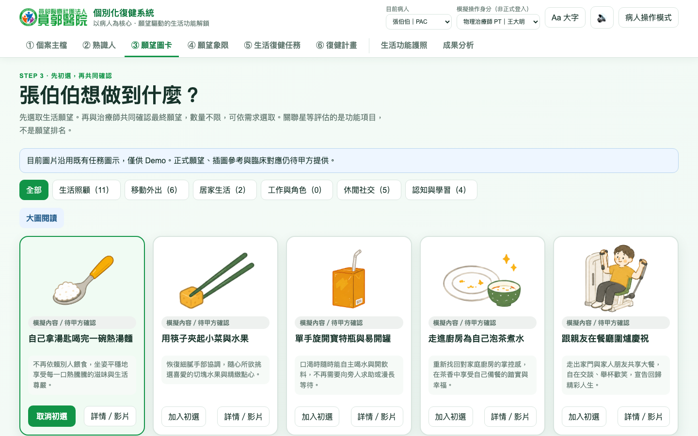

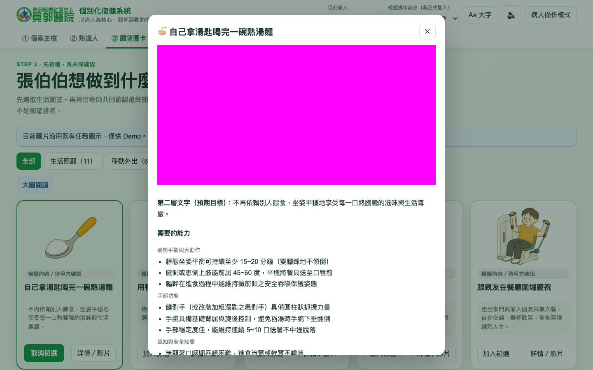

> 圖說：上圖為圖卡牆。已加入初選的卡片以綠框標示。下圖為單張詳情。

---

### 階段 ④：生活功能象限

**做什麼**

- 系統依最終願望，帶出相關的「生活功能項目」。
- 每個項目的星等，代表幾個願望共同需要它。星等不是能力或意願分數。
- 病人與家屬把項目放進四個象限。縱軸是急迫性，橫軸是重要性。
- 象限只給「暫定」的短期或長期建議。最後由治療師逐項決定。

```
 急迫性 高
    ▲
┌───────────────────┬───────────────────┐
│ Q3 急迫不重要     │ Q1 重要且急迫     │
│ 暫定：短期、       │ 暫定：短期優先    │ ◀── 最先處理
│ 可請照顧者協助     │                   │
├───────────────────┼───────────────────┤
│ Q4 不重要不急迫   │ Q2 重要不急迫     │
│ 暫定：暫緩，       │ 暫定：長期目標    │
│ 定期再評估         │                   │
└───────────────────┴───────────────────┘ ──▶ 重要性 高
```

**院長可強調**

- 項目放在哪個象限，由病人與家屬表達。治療師再依專業判斷，決定短期或長期。
- 團隊把有限的治療時間，先用在病人最重視、最急的事。

**系統操作畫面**

操作步驟：

1. 進入「④ 願望象限」（畫面標題：「哪些功能最重要？哪些最急？」）。左側為「待放置」項目。
2. 拖曳項目到四個象限。平板可先點項目，再按「放入 Q1／Q2／Q3／Q4」。
3. 下方「放置結果」依象限列出結果。

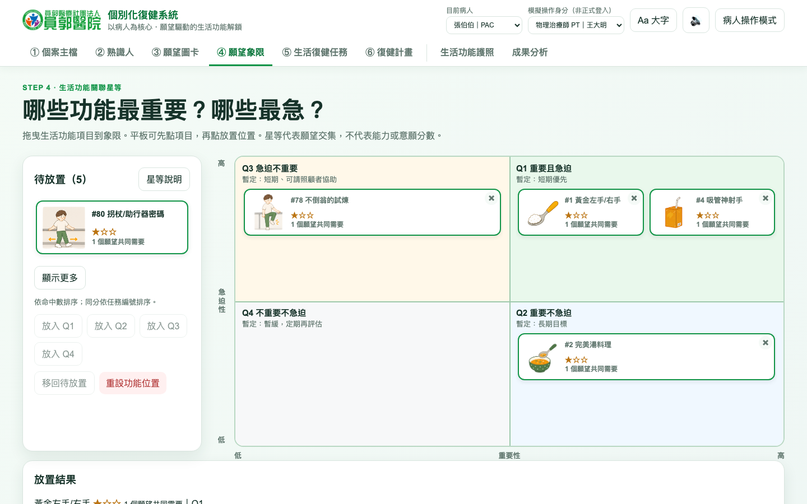

> 圖說：Q1（重要且急迫）暫定短期優先。放置結果只供參考，最後由治療師決定。

---

### 階段 ⑤：選任務（生活復健任務）

**做什麼**

- 治療師把願望連到「生活復健任務」。
- 任務共 150 項，分成食、衣、住、行、育、樂六個領域。
- 每個領域有銅、銀、金三級。

```
   願望：自己拿湯匙喝完一碗熱湯麵
        │
        ▼
   食 ：黃金左手/右手 → 完美湯料理 → 吸管神射手

   願望：拿著單拐在室內客廳平穩步行
        │
        ▼
   行 ：不倒翁的試煉 → 拐杖/助行器密碼 → 走廊急先鋒 → 倒車雷達開關

        150 項任務，所有照護模式的病人都可以使用
```
（任務名稱取自系統的「願望 → 相關任務」對應。）

**院長可強調**

- 一個願望會拆成多個具體任務。
- 若病人屬於「一般復健」或「OPD」，選完任務就可儲存，流程結束。

**系統操作畫面**

操作步驟：

1. 進入「⑤ 生活復健任務」。可依 食、衣、住、行、育、樂 篩選。
2. 與願望相關的任務會顯示星等與「N 個願望」。
3. 點任務卡選取。右上角顯示「已選 N 項」。
4. 若病人屬一般復健或 OPD，按「儲存本次任務紀錄」，流程結束。

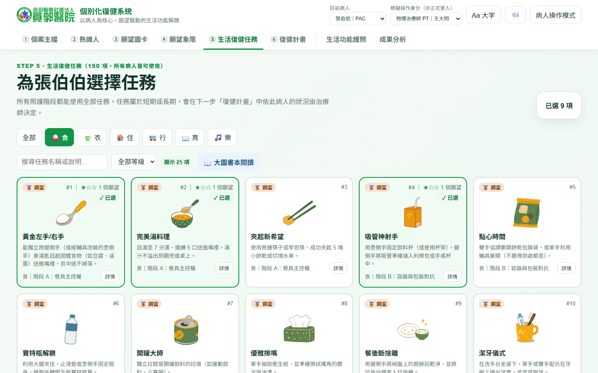

> 圖說：每張任務卡標示銅、銀、金級與所屬階段。

---

### 階段 ⑥：復健計畫與追蹤

**做什麼**

- 治療師訂出完整復健計畫。
- 系統記錄每一次修訂。

```
 預期目標 ─▶ 長期目標 ─▶ 短期目標 ─▶ 任務分短/長期 ─▶ 預後目標
 （來自願望）                         （治療師逐項決定）   （可用預設片語，
                                                          或 AI 產生草稿）
```

**追蹤機制**

```
   儲存計畫 ──▶ v1
        │
        ├─ 定期檢討：系統預設 14～21 天，可依照護模式或個案調整
        │
        └─ 週期修訂：依個案設定天數或日期 ──▶ v2、v3 …
                     （必填原因，保留舊版，可比較差異）
```

**院長可強調**

- 每次儲存都是新版本。舊版本不會消失。
- 系統依個案設定的天數或日期提醒修訂。住院週期不同的病人，可設定不同的提醒。計畫隨時可修訂。
- AI 只產生草稿。專業人員必須確認內容。

**系統操作畫面**

操作步驟（以張伯伯為例）：

1. 進入「⑥ 復健計畫」。頂部顯示「檢討與修訂提醒」。張伯伯轉入 PAC 後，治療師設定每 60 天修訂；本輪（自 v1 起）已滿 63 天，系統提醒需重新修訂。展開「提醒設定」可改為其他天數或指定日期。
2. 檢查「① 患者預期目標」。內容由願望帶入，治療師可修改。
3. 為每項任務決定「短期」或「長期」。
4. 在「⑤ 預後目標」點預設片語，或按「AI 依預期目標產生」。
5. 修改 AI 草稿，確認內容。
6. 按「儲存為新版本」，選修訂類型並填寫原因。
7. 在「版本歷程」按「檢視內容與差異」，比較各版本。
8. 到「後台管理 → 操作紀錄」，查看誰、何時、做了什麼。

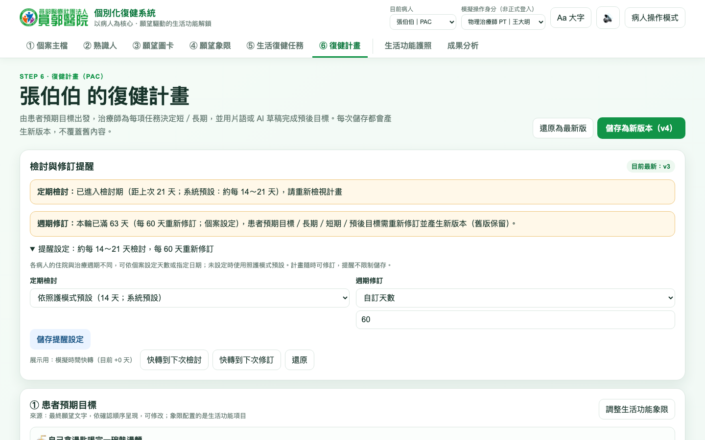

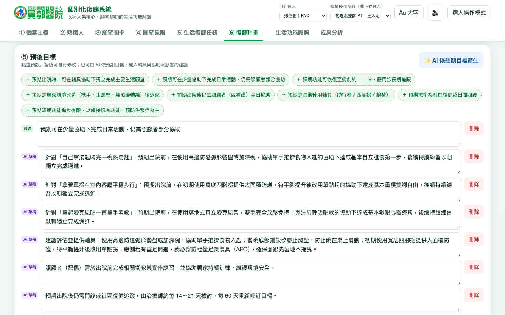

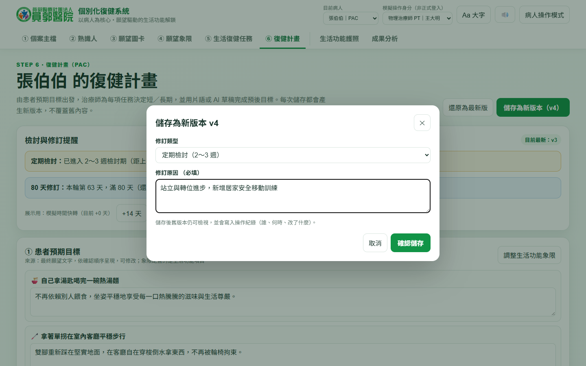

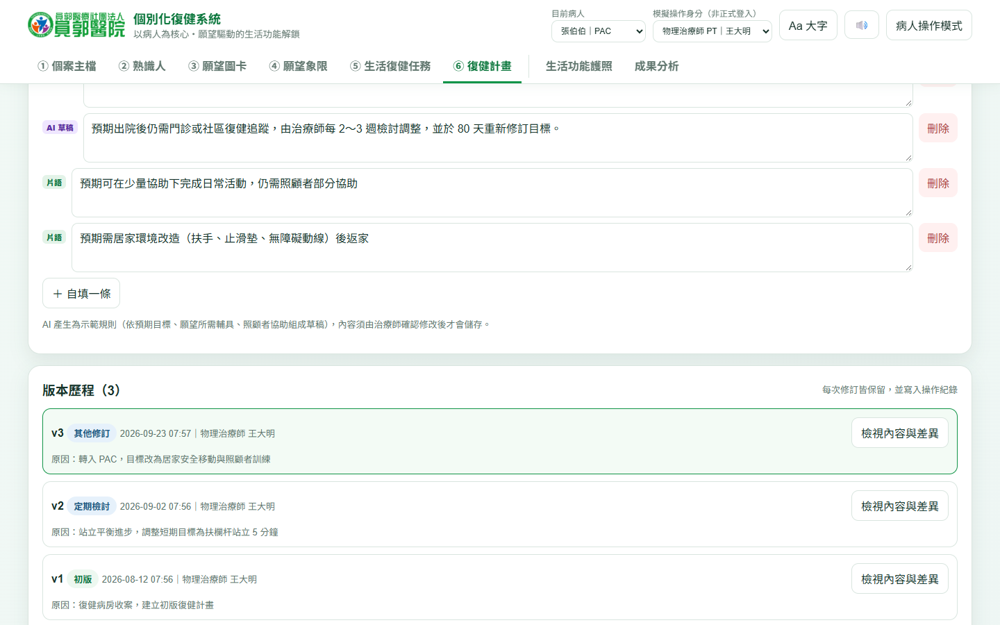

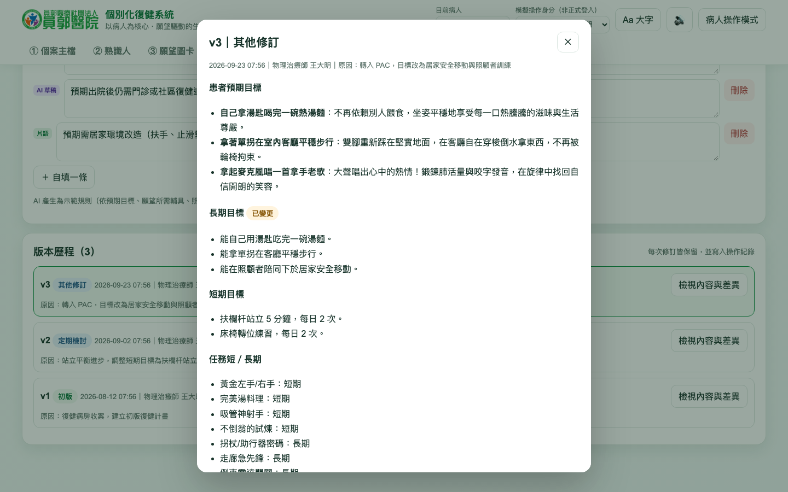

> 圖說：AI 草稿標示「AI 草稿」標籤。專業人員修改後才儲存。每次儲存都新增一個版本。

---

## 4. 病人端：生活功能解鎖護照

階段 ⑥ 之後，病人拿到自己的「護照」。護照貫穿住院期間，直到出院。

```
   ┌────────────── 生活功能解鎖護照 ──────────────┐
   │                                              │
   │  任務闖關                                    │
   │      食 衣 住 行 育 樂                       │
   │      🥉 銅 ─▶ 🥈 銀 ─▶ 🥇 金                 │
   │      完成任務 ─▶ 解鎖 ─▶ 慶祝畫面            │
   │                                              │
   │  願望與目標                                  │
   │      我的願望 ─▶ 我的目標 ─▶ 對應任務        │
   │                                              │
   └──────────────────────────────────────────────┘
```

| 對象 | 好處 |
|---|---|
| 病人 | 看得見自己的進步，願意持續練習 |
| 家屬 | 知道病人的目標，知道如何協助 |
| 治療團隊 | 用同一份資料討論，節省溝通時間 |

**系統操作畫面**

操作步驟：

1. 進入「生活功能護照」。上方顯示已解鎖項目數與達成率，接著是獎盃櫃與成就徽章。
2. 往下看「我的願望與目標」：長期、短期與預後目標，以及每個願望對應的生活任務。
3. 點任務卡，更新狀態（未開始、進行中、已解鎖）與共學夥伴。
4. 任務解鎖時，系統顯示慶祝畫面。進度、獎盃與願望對應同時更新。
5. 最下方為 150 項生活任務，可依食、衣、住、行、育、樂切換。

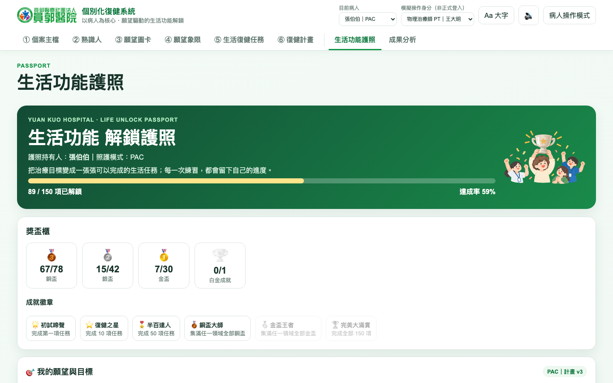

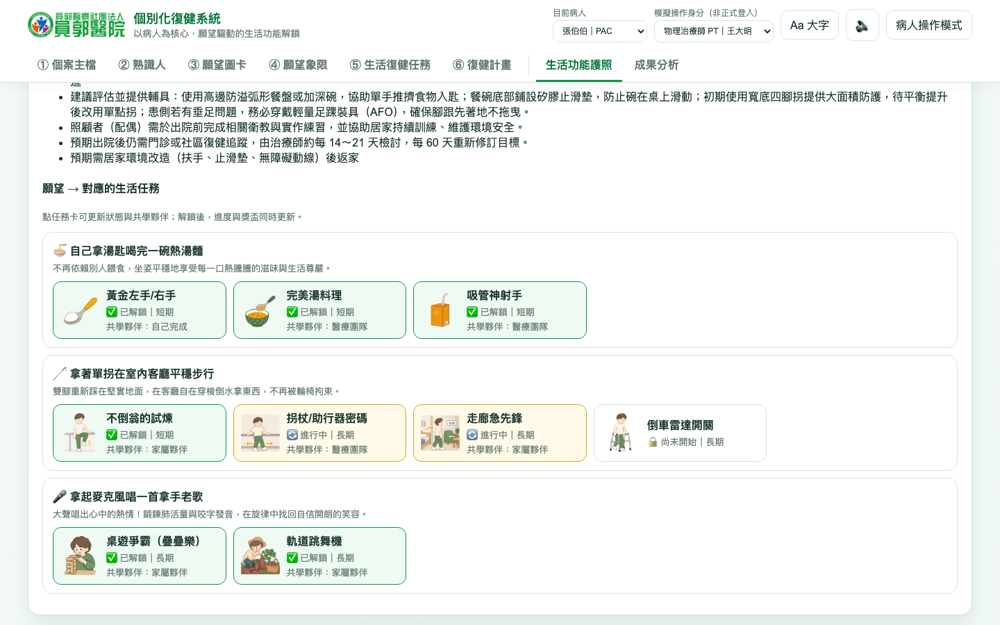

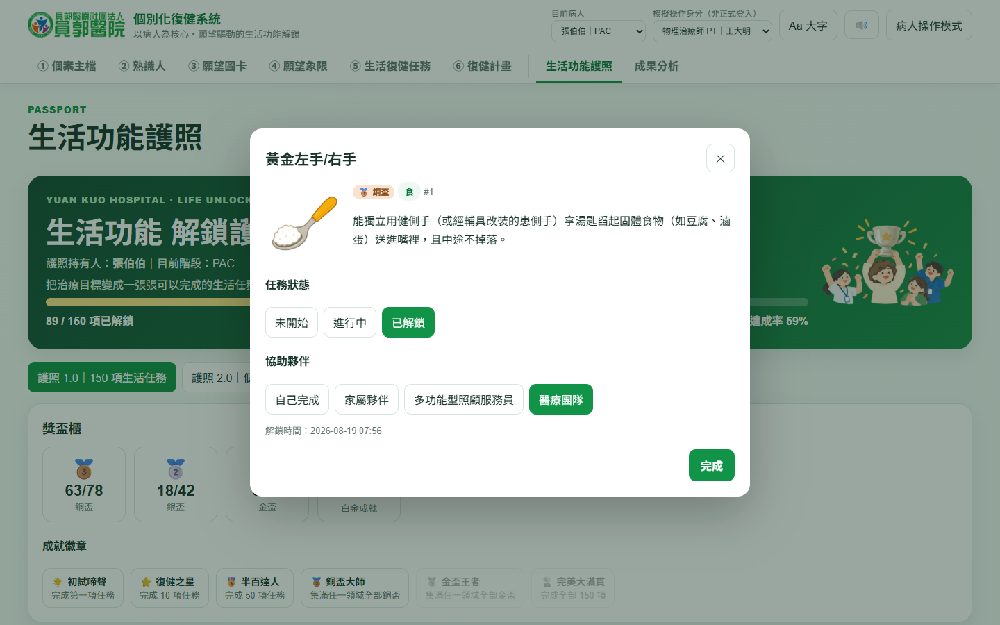

> 圖說：病人與家屬看同一份資料。進度一目了然。

---

## 5. 出院：成果帶得走

出院時，病人帶走已解鎖的成果。目前系統與規劃如下。

```
   目前系統已有                       規劃中
   ✔ 生活功能護照：解鎖進度與獎盃     ○ 入院與出院的前後比較
   ✔ 復健計畫：版本歷程與差異         ○ 願望與目標達成情形
   ✔ 跨專業整合報表                   ○ 居家／社區復健建議
        │
        ▼
   病人轉入 一般復健／OPD，主檔與歷程繼續使用
```

---

## 6. 品質與安全保障

| 項目 | 作法 |
|---|---|
| 可追溯 | 重要操作寫入操作紀錄（誰、何時、做了什麼） |
| 不覆蓋 | 照護模式、熟識人、計畫皆保留歷史版本 |
| 人為把關 | AI 只提供草稿。專業人員必須確認 |
| 資料串接 | 系統預留 HIS、PAC、杏翔識別碼，日後可串接 |

**系統操作畫面：操作紀錄**

操作步驟：

1. 將操作身分切換為「管理員」，進入「後台管理」。
2. 點「操作紀錄（Audit Log）」。
3. 查看每筆紀錄的時間、操作者、病人與內容。

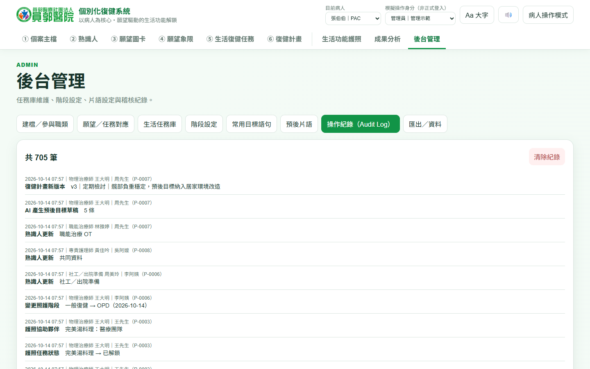

> 圖說：計畫新版本、AI 產生草稿、照護模式變更、熟識人更新，皆有紀錄。

---

## 7. 目前進度與後續規劃

**現況（請如實報告）**

- 系統為展示版。資料存在本機瀏覽器；預計 12 月底改用正式資料庫。
- 示範資料皆為虛構。
- AI 預後目標為規則式示範，尚未接入 AI 模型。
- 尚未串接 PAC 與杏翔；串接排在第二期。
- 「成果分析」已有示範頁：個人六大領域雷達圖，加上全體病人的各領域解鎖率、照護模式分布、願望類別與每週累積解鎖。數字由示範資料即時計算，不是正式統計。
- 「出院成果」的前後比較、目標達成情形、居家／社區復健建議，尚未實作。

**後續**

```
 ① 流程確認 ──▶ ② 系統落地 ──▶ ③ 場域示範 ──▶ ④ 系統串接
 （現在～11 月）  （預計 12 月底）（預計 1 月～3/30）（第二期）
  確認操作流程     Server、後端    100 個案        PAC、
  可操作展示版     資料庫上線      約 3 個月示範   杏翔系統
 （時程為會議中的預計目標；100 個案期程可能受資料準備、春節與院內配合影響）
```

---

## 8. 院長結語（可直接念）

> 這套系統不是多一張表單。
> 它讓病人從入院第一天，就說出自己想回到什麼樣的生活。
> 團隊依照病人的願望訂計畫，每次修訂都有紀錄。
> 病人出院時，帶走的不只是病歷，還有自己解鎖的成果。
> 我們希望在主管機關的指導下，把這個模式做得更完整。

---

## 附錄：預期提問與回答

| 問題 | 建議回答 |
|---|---|
| 病人答不出願望怎麼辦？ | 病人可由家屬協助。團隊可用圖卡引導。圖卡使用大字模式與大圖書本閱讀 |
| 願望不切實際怎麼辦？ | 願望只是起點。治療師把願望拆成可達成的短期與長期目標 |
| 資料安全如何確保？ | 目前展示版只用虛構資料。正式上線將使用正式 API、資料庫與登入權限 |
| AI 會取代治療師嗎？ | 不會。AI 只產生草稿。專業人員必須確認 |
| 每種照護模式都要做計畫嗎？ | 不一定。院方可依照護模式設定。PAC 與復健病房啟用，一般復健與 OPD 為選用 |

---

## 簡報頁面對照（HTML 簡報，共 30 頁）

對應檔案：`院長專用個別人照護系統介紹.html`。

**封面**：左上為員郭醫院（甲方）Logo，右上為昕力資訊 TPI（乙方）Logo。背景為醫院插圖（`_SVG/cover_bg.svg`）。

**呈現方式**：條列與表格頁已改為圖解（`_SVG/`）。系統畫面頁使用 `_screens/` 截圖，並加一句重點。

| 頁 | 章節 | 頁面標題 | 呈現 | 畫面頁重點句 |
|---|---|---|---|---|
| 1 | 封面 | 個別化照護系統　院長報告 | 封面 | |
| 2 | 開場與背景 | 數位整合跨專業資訊，推動個別化復健照護 | 圖解：①②③ 流程 | |
| 3 | 開場與背景 | 四個現況問題，四個系統作法 | 圖解：問題 → 作法 | |
| 4 | 六個階段 | 六個階段總覽 | 圖解 | |
| 5 | 六個階段 | 階段①　建立個案主檔 | 圖解：建檔 + 四種照護模式 | |
| 6 | 六個階段 | 個案主檔與照護模式歷程 | 畫面 ×2 | 病人轉換照護模式時，系統新增一筆歷程，舊資料不覆蓋 |
| 7 | 六個階段 | 階段②　熟識人資料：八個專業共填，可彈性增加 | 圖解：八個專業與其他身分匯入一份資料 | |
| 8 | 六個階段 | 熟識人：跨專業總覽 | 畫面 | 八個專業各填各的欄位；每次修改都留下填寫者與時間 |
| 9 | 六個階段 | 階段③　28 張願望圖卡 | 圖解：圖卡牆 → 預期目標 | |
| 10 | 六個階段 | 願望圖卡：大圖、大字 | 畫面 ×2 | 病人用大圖、大字自己選，長者也能操作 |
| 11 | 六個階段 | 階段④　生活功能象限：先做重要又急迫的事 | 圖解：四象限（Q1～Q4） | |
| 12 | 六個階段 | 生活功能象限：重要性 × 急迫性 | 畫面 | Q1「重要且急迫」暫定短期優先，最後由治療師決定 |
| 13 | 六個階段 | 階段⑤　一個願望，拆成多個生活任務 | 圖解：願望 → 任務鏈 + 六大領域 + 銅銀金 | |
| 14 | 六個階段 | 生活復健任務：150 項任務庫 | 畫面 | 一個願望拆成多個任務；150 項任務所有照護模式共用 |
| 15 | 六個階段 | 階段⑥　治療師訂出完整復健計畫 | 圖解：目標鏈 + 版本 + AI 草稿流程 | |
| 16 | 六個階段 | 復健計畫：提醒與 AI 草稿 | 畫面 ×2 | AI 草稿標示標籤，專業人員修改後才儲存 |
| 17 | 六個階段 | 儲存新版本與版本歷程 | 畫面 ×2 | 每次儲存都是新版本，修訂原因必填 |
| 18 | 六個階段 | 每次儲存都是新版本 | 圖解：v1 → v2 → v3 | |
| 19 | 六個階段 | 版本比較：標示「已變更」 | 畫面 | 每次儲存都是新版本，舊版不消失，差異一目了然 |
| 20 | 病人端與出院 | 生活功能解鎖護照 | 圖解 | |
| 21 | 病人端與出院 | 生活功能護照：願望、目標與任務 | 畫面 ×3 | 150 項任務連到病人的願望與目標，進度一目了然 |
| 22 | 病人端與出院 | 護照對三方的好處 | 圖解：病人、家屬、治療團隊 | |
| 23 | 病人端與出院 | 出院：成果帶得走 | 圖解：目前已有 vs 規劃中 | |
| 24 | 保障與進度 | 四項品質與安全保障 | 圖解：四張圖示卡 | |
| 25 | 保障與進度 | 後台管理：操作紀錄 | 畫面 | 誰、何時、做了什麼，全部可追溯 |
| 26 | 保障與進度 | 現況：展示版 | 圖解：四項狀態 | |
| 27 | 保障與進度 | 時程：從流程確認到場域示範 | 圖解：時程（預計 12 月底落地、目標 3/30 示範結束、第二期串接） | |
| 28 | 保障與進度 | 成果分析：雷達圖與群體統計 | 畫面（示範） | 個人六大領域雷達圖，加上全體病人各領域解鎖、照護模式與願望類別統計 |
| 29 | 結語與問答 | 不是多一張表單 | 圖解：三項結語 | |
| 30 | 結語與問答 | 預期提問與回答 | 圖解：問題 → 回答 | |

**說明**

- 階段⑥的 4 張畫面（第 3 節）在簡報分成第 16、17 頁。
- 簡報中的「重點句」只出現在畫面頁，用來取代口頭補充。
- 第 9 頁圖卡牆為系統中的真實願望（名稱為縮短版）。第 13 頁的任務名稱，取自系統的「願望 → 相關任務」對應。
- 第 23 頁的「規劃中」項目，目前系統尚未實作。
- 所有系統畫面（`_screens/`）的示範資料，都是用瀏覽器實際操作系統產生：新增病人、填熟識人、選願望、放象限、選任務、建立與修訂復健計畫、在護照解鎖任務。操作時用「模擬時間快轉」讓紀錄分布在 8 月中到 10 月中。畫面以張伯伯為主。
- 第 28 頁的「成果分析」畫面，來自示範系統新增的「成果分析」頁。頁面以示範資料即時計算，不是正式統計。
